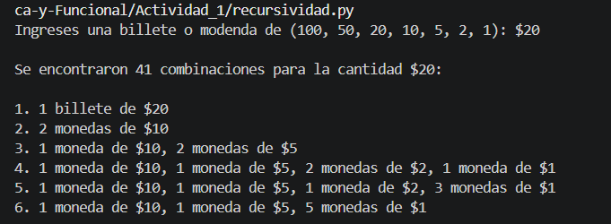

# Ejercicio 1 - Recursividad e iteraciones.
## Descomposicion de cantidades en combinaciones, utilizando demoninaciones mas pequeñas.

**Instrucciones**

Hacer un programa el cual divida en cantidades mas pqueñas una cantidad utilizando billetes de 100, 50, 20 y monedas de 10, 5, 2 y 1, y muestre las diferentes combinaciones utilizando recursividad e iteraciones.

### Desarrollo

Para el desarrollo de la actividad se tubo como restriccion que solamente se podian utilizar los billetes de 100, 50 y 20, asi como las monedas de 10, 5, 2 y 1 para poder hacer diferentes combinaciones al descomponer una cantidad, asi mismo solo se puede utilizar iteraciones y recursividad. Por tal motivo dentro de la logica de ejecucion el metodo para poder obtener las combinaciones al descomponer una cantidad es difente, miestras que el resto del codigo se comparte en ambas versiones.

La actividad fue realizada en python dado que es un lenguaje que tiene una facil escritural y permite poder desarrollar de una manera muy sensilla la actividad antes planteada.

Como elmentos compartidos que tiene ambos codigos son variables globales de los billetes y monedas que se pueden usar, y los metodos para poder imprimr en pantalla y el metodo main, miestras que el metodo de combinaciones es diferentes de acuerdo a si se utilizan interaciones y recursividad.

Las variables globales constantes son las siguientes:

```
DENOMINACIONES = [100, 50, 20, 10, 5, 2, 1]
BILLETES = {100, 50, 20}
MONEDAS = {10, 5, 2, 1}
```

En donde DENOMNACIONES son las cantidades validas en las cuales se puede dividir una cantidad, esto quiere decir que si se ingresa la cantida: *50*, solamente se pueden utilizar las cantidades de DENOMINACIONES para obtener las posibles divisiones de ese valor. Miestras que BILLETES y MONEDAS, son dos listas utilizadas para poder difenreciar que tipo de cantidad es la que se utiliza al momento de mostrar el resultado en pantalla.

Se tiene la funcion text_comb(), la cual recibe como parametro las combinaciones obtenidas en la funcion enc_comb(); que es la funcion que obtiene las combinaciones ya sea utilizando recursividad o iteraciones, en la funcion text_comb() nos permite generar un texto legible que contiene las combinaciones antes generadas en formato de texto, especificando la cantidad de billetes o monedas utilizadas (utilizando las variables globales antes definidas), la cual retorna un arreglo con el texto obtenido.

```
def texto_comb(combinacion):
    conteo = {}
    for valor in combinacion:
        conteo[valor] = conteo.get(valor, 0) + 1

    partes = []
    for denominacion in DENOMINACIONES:
        if denominacion in conteo:
            tipo = "billete" if denominacion in BILLETES else "moneda"
            cantidad = conteo[denominacion]
            plural = "s" if cantidad > 1 else ""
            partes.append(f"{cantidad} {tipo}{plural} de ${denominacion}")
    return ", ".join(partes)
```

Dentro del codigo se tiene un diccionario llamado conteo, con el cual se cuenta cuantas veces aparece cada una de las denominaciones utilizando un ciclo for, por ejemplo, si se obtuvieron las combinaciones de 5, se debe obtener como resultado *{[5:1], [2:2, 1:1], [1:5]}*, despues de obtener la cantidad de cada una de las denominaciones, entra en otro ciclo for, con el cual crea el texto, que vera el usuario.

Por ultimo se tiene la funcion main(), aqui se le solicita al usuario que ingrese la cantidad y se manda a llamar el metodo que genera las combinaciones, donde despues de obtener las combinacion ya sea utilizando recursividad o iteraciones se imprime en pantalla el resultado.

```
def main():
    cantidad = int(input("Ingreses una billete o modenda de (100, 50, 20, 10, 5, 2, 1): $"))

    combinaciones = enc_comb(cantidad, DENOMINACIONES)

    print(f"\nSe encontraron {len(combinaciones)} combinaciones para la cantidad ${cantidad}:\n")
    for i, combinacion in enumerate(combinaciones, start = 1):
        print(f"{i}. {texto_comb(combinacion)}")
```

#### Recursividad

Para poder obtener las difernetes combinaciones que descomponen una cantidad utilizando la recursividad se utilizo la funcion enc_comb(), en donde se reciben com parametro el valor (la cantidad que el usuario introduce), la denominacion (que son los valores con los cuales se puede dividir una cantidad), el indice (indica que denominacion se esta utilizando para dividir la cantidad introducida por el usuario) y list_comb (es la lista que contine la combinacion que se este contruyendo). 
En esta funcion principlamnete se va a ir obtenidno cada una de las combinaciones empezando con la denominacion mas grande 100 hasta llegar a la mas pequeña 1, esto se ira repitiendo recursivamente con cada cantidad hasta terminar en 1, por ejemplo si se quiere saber las combinaciones de 5, primero obtendra cuantas veces cabe 100, 50, 20, etc hasta llegar a 1, y cuando llegue a una cantidad factible empezara a obtener las combinaciones, en este caso llegara a 5, y despues seguira con el siguiente valor que seria 2, y de hay obtendira cuants veces cabe 2 en 5, donde la primera combinacion seria [2,2,1], de hay buscaria la siguiente combinacion donde utilizando todavia el 2, sacaria la combinacion [2,1,1,1], asi seguiria hasta llegar al valor mas pequeño, donde se obtendria [1,1,1,1,1], y al ser 1 el valo mas pequeño se termina la recursividad y retorna la lista de todas las posibles combinaciones. 

```
def enc_comb(valor, denominaciones, indice = 0, list_comb = None):
    if list_comb is None:
        list_comb = []

    combinaciones = []

    if valor == 0:
        return [list(list_comb)]

    if valor < 0 or indice >= len(denominaciones):
        return []

    denominacion = denominaciones[indice]

    max_veces = valor // denominacion
    for veces in range(max_veces, -1, -1):
        nuevo_comb = list_comb + [denominacion] * veces
        combinaciones += enc_comb (valor - denominacion * veces, denominaciones, indice + 1, nuevo_comb)

    return combinaciones
```

Como caso base que permite romper la recursividad tenemos 2 posibles casos, uno es cuando el valor es igual a 0 (esto quiere decir que se encontro una combinacion que satisface la cantidad dada utilizando las denominaciones validad), el cual retorna la combinacion, miestras que el segundo caso es cuando el valor es menos a 0 y el indice es igual o mayor al la longitud de las denominaciones (aqui se indica que la combinacion obtenida se pasa del valor deseado, quiere decir que si el valor ingresado es 5 la combinacion puede ser 2+2+2=6, donde sobre pasa el valor deseado) y regresa [].

Despues de obtener los casos bases se sigue coon el corazon del algoritmo en donde se utiliza la recursividad, aqui mismo se optine una variable que nos permite saber cuantas veces cabe una denominacion en el valor dado por el usuario, donde despues de obtener ese valor entramos a un ciclo for donde primero se contruye una nueva combinacion, por ultimo se entra en la recursividad en donde se mandan como parametro el nuevo valor (este valor se obtiene utilizando el valor actual, a l cual se le resta la denominacion actual menos la cantidad de veces que cabe esa denominacion en el valor actual), las denominaciones, el idice nuevp y la combinacion que se tiene actualmente. En donde esta iteracion se va repitiendo hasta llegar a un algun caso base que se tenga.

#### Iteraciones

Para poder obtener las diferentes combinaciones descomponiendo una cantidad utilizando iteraciones, al igual que en recursividad se utilizo la misma duncion enc_comb(), la cual solo recibe dos parametros, que son el valor dado por el usuario y las denominaciones que se pueden utilizar. Para poder realizar el proceso de manera iterativa se utiliza un ciclo while, el cual continua ejecurandose miestras existan elementos dentro de list_comb. Esta lista funciona como si fuera un pila, donde se van almacenando el valor que se debe descomponer, el indice de la denominacion que se este utlizando y ña combinacion que se ha construido.

```
def enc_comb(valor, denominaciones):

    combinaciones = []
    list_comb = [(valor, 0, [])]

    while list_comb:
        valor_actual, indice, combinacion =list_comb.pop()
        if valor_actual == 0:
            combinaciones.append(combinacion)
            continue
        if valor_actual < 0 or indice >= len(denominaciones):
            continue

        denominacion = denominaciones[indice]
        max_veces = valor_actual // denominacion

        for veces in range(max_veces + 1):
            nuevo_comb = combinacion + [denominacion] * veces
            nuevo_valor = valor_actual - denominacion * veces
            list_comb.append((nuevo_valor, indice + 1, nuevo_comb))

    return combinaciones
```
La lista list_comb permite sustituir el funcionamiento que anteriormente se utilizaba con la recursividad. En donde en lugar de que la funcion se vuelva a llamr a si misma para continuar con la siguiente denominacion , se agrega a list_comb, el cual es un nuevo estado que contiene el nuevo valor. Como condicion que permite finalizar el procesamiento se tienen dos posibles casos. el primero es cuando valor_actual es igual a 0 (esto quiere decir que se encomtro una combinacion exacta), el segundo caso es cuando es menor a 0 o cuando el indice es igual a la longitud de denominacion.

Despues se utiliza un ciclo for para probar todas las combinaciones posibles de la denominacion. En donde en cada iteracion se construyen nuevas combinaciones mediante nuevo_comb. En esta ocacion en lugar de realizar una llamda recursiva, se utiliza list_comb.append() para guardar el nuevo estado que sera procesado posteriormente. el ciclo while continua ejecutandose, sacando los estados utilizando pop() y procesandolos hasta que list_comb quede vacio. Cuando todo esto sucede, significa que ya se revisaron todas las posibles combinaciones y se retorna la lista combinacion con las combinaciones validas.

### Resultados

Como resultados esperados de esta actividad es que al introducir una cantida esta se descomponga en cantidades mas pequeñas mustrando las distintas conbinaciones validas, para ello se tiene como ejemplo que compruebe el funcionamiento del programa la cantidad de 20, en la cual al introducir la cantidad en nuestro programa utilizando tanto recursividad como interaciones se optiene los mismos resultados.

En este ejemplo al introducir 20, el programa empezara a dividir la cantidad primero usando billentes de 100, despues de 50 y asi sucecivamente hasta llegar las monedas de 1 peso, esto cabe recalcar que sera utilizando combinaciones validas de las mismas cantidades. 



como se muestra en la imgane da las cantidades a usar utilizando las monedas que sean validas. asi mismo en este ejemplo se utilizo la recursividad, pero asi mismo con iteraciones se optine el mismo resultado.
