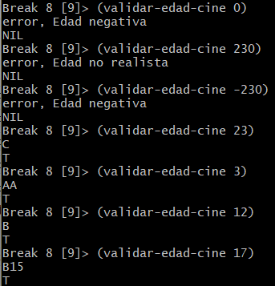
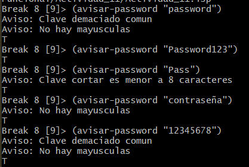
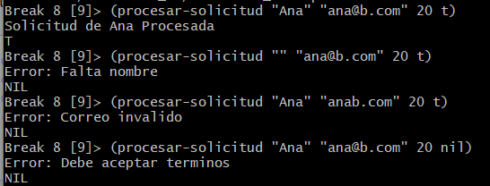
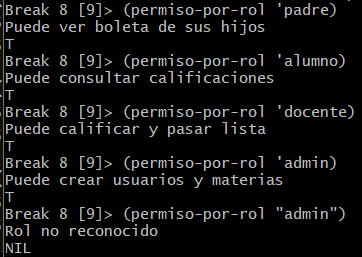
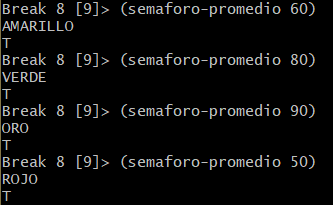
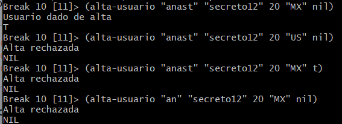
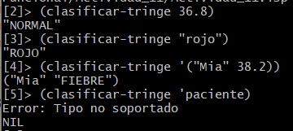
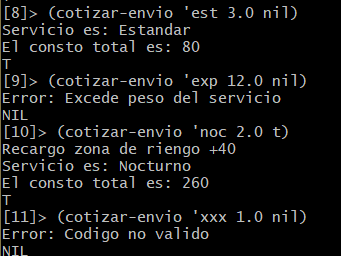
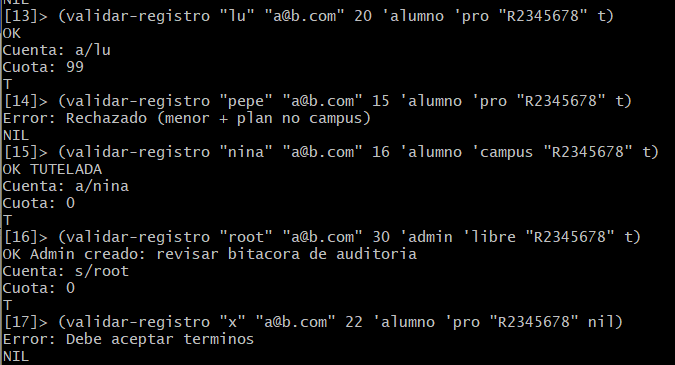
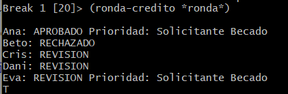

# Actividad 11 - Ejercicios de condicionales

## Desarrollo

### Ejercicio 1 - if: edad para el cine

´´´
(defun validar-edad-cine (?edad)
    (if (integerp ?edad)
        (if (> ?edad 0)
            (if (< ?edad 120)
                (if (and (> ?edad 0) (< ?edad 12))
                    (if (format t "AA") t t)
                    (if (and (>= ?edad 12) (< ?edad 15))
                        (if (format t "B") t t)
                        (if (and (>= ?edad 15) (< ?edad 18))
                            (if (format t "B15") t t)
                            (if (and (>= ?edad 18))
                                (if (format t "C") t t)
                            )
                        )
                    )
                )
                (format t "error, Edad no realista")
            )
            (format t "error, Edad negativa")
        )
        (format t "error (no entero)")
    )
)
´´´

Resultados de ejecucion.

### Ejercicio 2 - when: avisos, no bloqueos

´´´
(defun avisar-password (clave)
    (when (< (length clave) 8)
        (format t "Aviso: Clave cortar es menor a 8 caracteres~%")
    )
    (when (or (string= clave "12345678") (string= clave "password"))
        (format t "Aviso: Clave demaciado comun~%")
    )
    (when (string= clave (string-downcase clave))
        (format t "Aviso: No hay mayusculas~%")
    )
    t
)

´´´

Resultados de ejecucion.

### Ejercicio 3 -unless: no procesar si faltan datos

´´´
(defun procesar-solicitud (nombre correo edad acepta-terminos)
    (declare (ignore edad))
    (unless (string/= nombre "")
        (return-from procesar-solicitud (reportar-error "Falta nombre"))
    )
    (unless (search "@" correo)
        (return-from procesar-solicitud (reportar-error "Correo invalido"))
    )
    (unless acepta-terminos
        (return-from procesar-solicitud (reportar-error "Debe aceptar terminos"))
    )
    (format t "Solicitud de ~A Procesada~%" nombre)
    t
)
´´´

Resultados de ejecucion.

### Ejercicio 4 - case: roles de un sistema escolar

´´´
(defun permiso-por-rol (rol)
    (case rol
        (admin (format t "Puede crear usuarios y materias~%") t)
        (docente (format t "Puede calificar y pasar lista~%") t)
        (alumno (format t "Puede consultar calificaciones~%") t)
        (padre (format t "Puede ver boleta de sus hijos~%") t)
        (otherwise (format t "Rol no reconocido~%") nil)
    )
)
´´´

El hecho de que el otherwise rechaza el ´"admin"´ es devido a que cuando usa comillas lo interpreta como una cadena mientras que cuando es ´´admin´ lo evalua como un simbolo.

Resultados de ejecucion.

### Ejercicio 5 - cond: semaforo de promedio

´´´
(defun semaforo-promedio (p)
    (unless (numberp p)
        (return-from semaforo-promedio (reportar-error "Error"))
    )
    (unless (and (> p 0) (< p 100))
        (return-from semaforo-promedio (reportar-error "Promedio fuera de [0, 100]"))
    )
    (cond 
        ((< p 60) (format t "ROJO") t)
        ((< p 80) (format t "AMARILLO") t)
        ((< p 90) (format t "VERDE") t)
        (t (format t "ORO") t)
    )
)
´´´

Resultados de ejecucion.

### Ejercicio 6 - and / or / not + if: alta de usuario

´´´
(defun alta-usuario (user pass edad pais bloqueado)
    (if (and (and (stringp user) (> (length user) 3)) (and (stringp pass) (> (length pass) 8)) (> edad 13) (or (string= "MX" pais) (string= "CO" pais) (string= "AR" pais)) (not bloqueado))
        (if (format t "Usuario dado de alta" ) t t)
        (format t "Alta rechazada")
    )
)
´´´

Resultados de ejecucion.

### Ejercicio 7 - typecase: triage segun el tipo de dato

´´´
(defun clasificar-tringe (dato)
    (typecase dato
        (number 
            (cond
                ((< dato 35) "HIPOTERMIA")
                ((< dato 37.5) "NORMAL")
                ((< dato 39) "FIEBRE")
                (t "FIEBRE ALTA")
            )
        )
        (string 
            (cond
                ((string-equal dato "rojo") "ROJO")
                ((string-equal dato "naranja") "NARANJA")
                ((string-equal dato "verde") "VERDE")
                (t "OTRO COLOR")
            )
        )
        (list 
            (let (
                    (nombre (first dato))
                    (temperatura (second dato))
                 )
                 (list nombre (clasificar-tringe temperatura))
            )
        )
        (t (reportar-error "Tipo no soportado"))
    )
)
´´´

Resultados de ejecucion.

### Ejercicio 8 - case de codigo + when de recargo (paqueteria)

´´´
(defun cotizar-envio (codigo peso zona-riesgo)
    (multiple-value-bind (base peso-max nombre)
        (case codigo
            (est (values 80 20 "Estandar"))
            (exp (values 160 10 "EXpress"))
            (noc (values 220 5 "Nocturno"))
            (int (values 450 15 "Internacional"))
            (t (return-from cotizar-envio (reportar-error "Codigo no valido")))
        )

        (unless (< peso peso-max)
            (return-from cotizar-envio (reportar-error "Excede peso del servicio"))
        )
        (when zona-riesgo
            (setq base (+ base 40))
            (format t "Recargo zona de riengo +40~%")
        )
        (format t "Servicio es: ~A~%" nombre)
        (format t "El consto total es: ~A~%" base)
        t
    )
)
´´´

Resultados de ejecucion.

### Ejercicio 9 - formulario completo: mezclar if, when, unless y case

´´´
(defun validar-registro (usuario correo edad rol plan password acepta-termino)
    (declare (ignore correo))
    (let ((prefijo nil)
          (cuota nil)
          (aviso ""))
        ;; [unless] terminos
        (unless acepta-termino
            (return-from validar-registro (reportar-error "Debe aceptar terminos"))
        )
        ;; [if] edad / plan
        (if (< edad 13)
            (return-from validar-registro (reportar-error "Edad Rechazada"))
            (if (and (>= edad 13) (<= edad 17))
                (if (eq plan 'campus)
                    (setq aviso 'tutelada)
                    (return-from validar-registro (reportar-error "Rechazado (menor + plan no campus)"))
                )
            )
        )
        ;; [case] rol
        (case rol
            (alumno (setq prefijo "a/"))
            (docente (setq prefijo "d/"))
            (admin (setq prefijo "s/"))
            (t (return-from validar-registro (reportar-error "Rol invalido")))
        )
        ;; [case] plan
        (case plan
            (libre (setq cuota 0))
            (pro (setq cuota 99))
            (campus (setq cuota 0))
            (t (return-from validar-registro (reportar-error "Plan invalido")))
        )
        ;; [when] admin
        (when (eq rol 'admin)
            (setq aviso "Admin creado: revisar bitacora de auditoria")
        )
        ;; [when] password
        (avisar-password password)
        (format t "OK ~A~%" aviso)
        (format t "Cuenta: ~A~A~%" prefijo usuario)
        (format t "Cuota: ~A~%" cuota)
        t
    )
)
´´´

Resultados de ejecucion.

### Ejercicio 10 - mini sistema: credito escolar

´´´
;;
(defstruct solicitante
    nombre
    promedio              ; 0-100
    materias-reprobadas
    beca                  ; T / NIL
    monto                 ; pesos
    historial             ; limpio | atrasos | desconocido
    semestre              ; 1-10
)             

;;
(defparameter *ronda*
    (list
        (make-solicitante :nombre "Ana"  :promedio 92 :materias-reprobadas 0
                            :beca t   :monto 1500 :historial 'limpio      :semestre 4)
        (make-solicitante :nombre "Beto" :promedio 68 :materias-reprobadas 1
                            :beca nil :monto 3000 :historial 'limpio      :semestre 3)
        (make-solicitante :nombre "Cris" :promedio 80 :materias-reprobadas 0
                            :beca nil :monto 9000 :historial 'atrasos     :semestre 6)
        (make-solicitante :nombre "Dani" :promedio 88 :materias-reprobadas 0
                            :beca nil :monto 4000 :historial 'limpio      :semestre 2)
        (make-solicitante :nombre "Eva"  :promedio 90 :materias-reprobadas 0
                            :beca t   :monto 5000 :historial 'desconocido :semestre 8)
    )
)

(defun validar-solicitante (promedio monto semestre)
    (unless (and (integerp promedio) (>= promedio 0) (<= promedio 100))
        (return-from validar-solicitante (reportar-error "Promedio fuera de rango [0, 100]"))
    )
    (unless (and (numberp monto) (> monto 0))
        (return-from validar-solicitante (reportar-error "El monto debe ser mayor a 0"))
    )
    (unless (and (integerp semestre) (>= semestre 1) (<= semestre 10))
        (return-from validar-solicitante (reportar-error "semestre fuera de rango [1, 10]"))
    )
    t
)

;;
(defun categoria-monto (monto)
    (cond
        ((< monto 2000) "BAJO")
        ((< monto 8000) "MEDIO")
        (t "ALTO")
    )
)

;;
(defun penalizacion-historial (historial)
    (case historial
        (limpio 0)
        (atrasos 2)
        (desconocido 1)
        (t 99)
        ;;(t (return-from penalizacion-historial (reportar-error "Invalido")))
    )
)

;;
(defun decidir-credito (reprobadas promedio penalizacion beca monto semestre)
    (unless (validar-solicitante promedio monto semestre)
        (return-from decidir-credito nil)
    )
    (if (or (> reprobadas 3) (< promedio 70) (>= penalizacion 99))
        "RECHAZADO"
        (if (and (>= promedio 85) (= penalizacion 0) (or (string= (categoria-monto monto) "BAJO") beca))
            "APROBADO"
            "REVISION"
        )
    )
)

;;
(defun decidir-prioridad (veredicto beca)
    (when (and beca (string/= veredicto "RECHAZADO"))
        (format t "Prioridad: Solicitante Becado")
    )
)

(defun ronda-credito (lista)
    (dolist (solicitante lista)
        (let ((veredicto
            (decidir-credito 
                (solicitante-materias-reprobadas solicitante)
                (solicitante-promedio solicitante)
                (penalizacion-historial (solicitante-historial solicitante))
                (solicitante-beca solicitante)
                (solicitante-monto solicitante)
                (solicitante-semestre solicitante)
            )
            ))
            (format t "~%~A: ~A " (solicitante-nombre solicitante) veredicto)
            (decidir-prioridad veredicto (solicitante-beca solicitante))
        )   
    )
    t
)
´´´

Para Eva como su historial es desconocido no se puede considerar limpia por tal motivo aunque tenga beca no se le puede aprovar.

Resultados de ejecucion.

