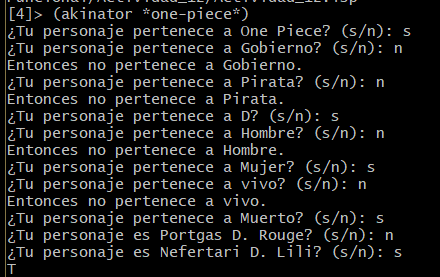
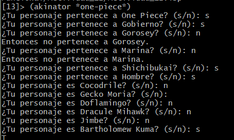
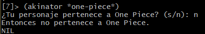

# Actividad 12 - Akinator con arbon n-ario

## Desarrollo

### Arbol n-ario

Para el desarollo del akinator se utilizo un arbol e-nario de los personajes de one piece el cual tiene una extension de 6 niveles de extension. Asi mismo se hizo con tres categorias los perosnaejs que pertenecen al gobierno, los que son piratas y los que tienen un D. en su nombre, despues de eso se dividio en diferentes categorias, por ejemplo en gobierno se dividio en gorosey, marina, etc, miestras que los piratas se dividieron en younkos, Shichibukai, peor generacion, etc, asi mismo en vivos y muertos u hombres y mujeres segun se nececitara.

De tal manera que el arbol n-ario de One piece queda de la siguinete manera en clisp.

```
(defparameter *one-piece*
  '("One Piece"
    ("Gobierno"
      ("Gorosey"
        ("Vivo"
          ("Actuales"
            "San Ethanbaron V. Nusjuro"
            "San Shepherd Ju Peter"
            "San Topman Warcury"
            "San Marcus Mars")
          ("Nuevo"
            "San Figarland Garling")
        )
        ("Muerto"
          "San Jaygarcia Saturn")
      )
      ("Marina"
        ("Almirante supremo"
          ("Antiguo"
            "Sengoku")
          ("Nuevo"
            "Akainu")
        )
        ("Almirante"
          ("Originales"
            "Kuzan \"Ao kiji\""
            "Sakazuki \"Aka Inu\""
            "Borsalino \"ki Saru\"")
          ("Nuevos"
            "Issho \"Fijitora\""
            "Aramaki \"Ryokugu\"")
        )
        ("Vicealmirante"
          "Monkey D. Garp"
          "Tsuru")
        ("Capitan"
          "Smoker"
          "Hina")
        ("Subordinados"
          "Coby"
          "Helmeppo"
          "Tashigi"
          "Jango"
          "Fullbody")
      )
      ("Shichibukai"
        ("Hombre"
          "Cocodrile"
          "Gecko Moria"
          "Doflamingo"
          "Dracule Mihawk"
          "Jimbe"
          "Bartholomew Kuma"
          "Marshall D. Teach"
          "Edward Weevil"
          "Trafalgar D. Water Law"
          "Buggy")
        ("Mujer"
          "Boa Hancock")
      )
    )
    ("Pirata"
      ("Peor generacion"
        ("Mujer"
          "Jewelry Bonney")
        ("Hombre"
          "Monkey D. Luffy"
          "Roronoa Zoro"
          "Marshall D. Teach"
          "Trafalgar D. Water Law"
          "Eustass Kid"
          "Killer"
          "Urouge"
          "Capone Bege"
          "Scratchmen Apoo"
          "Basil Hawkins"
          "x Drake")
      )
      ("Younkos"
        ("Anteriores"
          "Charlotte Linlin"
          "Kaidou"
          "Edward Newgate")
        ("Actuales"
          "Shanks"
          "Monkey D. Luffy"
          "Buggy"
          "Marshall D. Teach")
      )
      ("Sombrero de paja"
        ("Tiene fruta del diablo"
          ("Mujer"
            "Nico Robin")
          ("Hombre"
            "Monkey D. Luffy"
            "Tony Tony Chopper"
            "Brook")
        )
        ("No tiene fruta del diablo"
          ("Mujer"
            "Nami")
          ("Hombre"
            "Roronoa Zoro"
            "Sanji"
            "Franky"
            "Jimbe"
            "Usopp")
        )
      )
      ("Rey de los piratas"
        ("Vivo"
          "Silvers Rayleigh"
          "Scopper Gaban"
          "Shanks"
          "Buggy"
          "Crocus"
        ) 
        ("Muerto"
          "Gol D. Roger"
          "Kozuki Oden"
        )
      )
    )
    ("D"
      ("Hombre"
        ("vivo"
          "Monkey D. Luffy"
          "Marshall D. Teach"
          "Jaguar D. Saul"
          "Monkey D. Dragon"
          "Monkey D. Garp"
          "Trafalgar D. Water Law"
        )
        ("Muerto"
           "Gol D. Roger"
           "Portgas D. Ace"
           "Rocks D. Xebec"
           "Nefertari D. Cobra"
           "Clou D. Clover"
           "Davy D. Jones"
        )
      )
      ("Mujer"
        ("vivo"
          "Nefertari D. Vivi"
        )
        ("Muerto"
           "Portgas D. Rouge"
           "Nefertari D. Lili"
        )
      )
    )
  )
)
```

### Akinator

Para el funcionamiento del akinator se hicieron 2 funciones, una es la `recorrer-hijos` y `akinator`; con la primera funcion se recorre el arbol n-ario, la primera condicion sirve para indicar si la lista esta vacia `((null hijos) nil)`, en la cual si la lista es vacia devuelve un `T` miestras que si esta llena devuelve un `nil`. La segunda condicion comprueba si la cabecera de la lista es el personaje que se busca `((akinator (car hijos)) t)`, principlamente se utiliza la cabecera de la lista, donde si la respuesta es `t` se cumple la condicion miestras que si es `nil` entraria en la tercera condicion. En esta ultima condicion lo que hace es enviar la cola de la lista.

```
(defun recorrer-hijos (hijos)
  (cond
    ((null hijos) nil)
    ((akinator (car hijos)) t)
    (t (recorrer-hijos (cdr hijos)))
  )
)
```

Lo que hace la segunda funcion es hacer dos cosas principlamente la primera es comprobar si lo que recibe como paramentros la funcion akinator es una cadena o una lista, si es una cadena loq eu harias seria preguntar si hemos encontrado al personaje que buscabamos, en donde si es asi termina la ejecucion del programa, miestras que si no es asi se regresa y recorre alsiguinete personaje, miestras que si es un lista, pregunta si el personaje pertenece a la categoria actual o debe moverse a la siguiente hasta llegar a la categoria correcta, asi mismo en esta segunda opcion se manda a llamar a la funcion `recorrer-hijos`.

```
(defun akinator (arbol)
  (cond
    ((stringp arbol)
     (format t "¿Tu personaje es ~a? (s/n): " arbol)
     (string-equal (read-line) "s")
    )
    (t
      (format t "¿Tu personaje pertenece a ~a? (s/n): " (car arbol))
      (if (string-equal (read-line) "s")
         (recorrer-hijos (cdr arbol))
         (progn
           (format t "Entonces no pertenece a ~a.~%" (car arbol))
           nil
         )
      )
    )
  )
)
```

## Resultados

Se puede ver en los resultados como al ejecutar el programa va preguntando si pertenece o es un personaje dependiendo de si es una lista o una cadena el resultado que va reciviendo. Asi mismo se puede ver en la tercera imagen que al decir que no pertenece a ¨One piece¨ el programa termina ya que no hay mas ramas.





