# Operación Lambda — Informe
**Agente:** [Leonardo Blanco Ambriz / 23120519]

**Reglas**
- Trabajen individual (salvo indicación del docente).
- Intérprete: GNU CLISP (Common Lisp). No Emacs Lisp.
- Prohibido usar nth, second, third=… en la Misión 1: solo =car y cdr.
- Prohibido loop, dolist y do en toda la operación: las listas se recorren con mapcar (o con recursión si la misión lo permite).
- Cada misión pide código + salida de CLISP + respuesta breve. Sin salida = 0 en esa misión.
- Si una predicción "a mano" no coincide con CLISP, no la borren: anoten por qué se equivocaron.


## Misión 1 - El Expediente Desordenado

**Historia**

El analista anterior dejó anotaciones de la forma `(car (cdr (car ...)))` sin decir qué devuelven. Antes de tocar el teclado deben predecir cada resultado; después lo comprueban en CLISP.

- Tabla predicción vs CLISP (a–f):
- Errores de predicción y por qué:
- Puntos de Elena (expresión + salida):
- (car (cdr '(ana))):

| Clave | Expresion | Prediccion | CLISP |
|:----: | :----: | :----: | :----: |
|a | (car (cdr (car *agentes*))) | 28 | 28 |
|b | (car (car (cdr *agentes*))) | beto | BETO |
|c | (cdr (car (cdr (cdr *agentes*)))) | (22 1 morelia 45) | (22 1 MORELIA 45) |
|d | (car (cdr (cdr (cdr (car (cdr (cdr (cdr *agentes*)))))))) | zamora | ZAMORA |
|e | (caddr (cadr *agentes*)) | uruapan | 5 |
|f | (car (cdr (cdr (car (cdr (cdr (cdr (cdr *agentes*)))))))) | 2 | 2 |

*Error en la clave `c`*
Se tubo una salida diferente con clisp de la prediccion,y esto sucedio por que al momento de trasformar los `cadr` y `caddr` a sus versiones separadas los aplique mal, y por eso dio otro resultado.

*Funciones de `nombre`, `edad`, `nivel`, `base` y `puntos`*

*Funcion nombre*

Esta funcion nos devuelve el nombre de cada agente que le agregemos a la funcion, se puede ver en la imagen que con cada agente obtenmos su nombre.

```
(defun nombre (ag) 
  (car ag)
)
```
*Funcion edad*

Esta funcion nos devuelve la edad de cada agente que le agregemos a la funcion.

```
(defun edad (ag) 
  (car (cdr ag))
)
```
*Funcion nivel*

Esta funcion nos devuelve el nivel de cada agente que le agregemos a la funcion.

```
(defun nivel (ag) 
  (car (cdr (cdr ag)))
)
```
*Funcion base*

Esta funcion nos devuelve la base en la que se encuetra de cada uno de los agentes que le agregemos a la funcion.

```
(defun base (ag) 
  (car (cdr (cdr (cdr ag))))
)
```
*Funcion puntos*

Esta funcion nos devuelve los puntos de cada agente que le agregemos a la funcion.

```
(defun puntos (ag) 
  (car (cdr (cdr (cdr (cdr ag)))))
)
```
*Salida de las funciones nombre, edad, nivel, base y puntos*

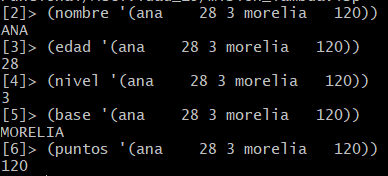

*Funcion puntos de Elena*

Esta funcion nos devuelve los puntos de elena mandandalo solamente el arreglo con todos los agentes, hasta encontrar al agente elena y devolver sus puntos.

```
(defun puntos_elena (ag)
  (car (cdr (cdr (cdr (cdr (car (cdr (cdr (cdr ag)))))))))
)
```

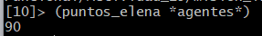

*Salida de:*
`(car (cdr '(ana)))`

La salida de esta instruccion nnos devuelve `NIL` esto es devido a que dentro de la lista que le mandamos hay implicitamente un `NIL` que seria la cola de la lista. A al utilizar primero un `cdr` quitamos de la lista el nombre de `ana` dejando los el `NIL` ya que es la cola de la lista. 

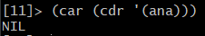

## Misión 2 - El Pase de Lista

**Historia**

El mando no quiere registros completos: quiere columnas. Con `mapcar` se aplica una función a cada elemento y se recibe una lista nueva del mismo tamaño.

- Salidas de pase-de-lista, nombre-y-nivel, cumpleanios, aplicar-bonos:
- ¿Por qué #'car?:

**Pase de lista**

```
(defun pase-de-lista (agentes)
  (mapcar #'nombre agentes)
)
```

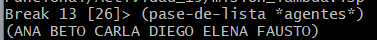


**Nombre y nivel**

```
(defun nombre-y-nivel (agentes)
  (mapcar (lambda (agente) (cons (nombre agente) (nivel agente))) agentes)
)
```

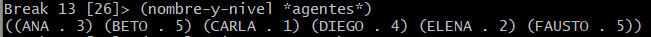

**Cumpleaños**

```
(defun cumpleanios (agentes)
  (mapcar (lambda (agente) (list (nombre agente) (+ 1 (edad agente)))) agentes)
)
```

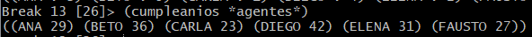

**Aplicar bonos**

```
(defun aplicar-bonos (agentes bonos)
  (mapcar (lambda (agente bono) (+ (puntos agente) bono)) agentes bonos)
)
```

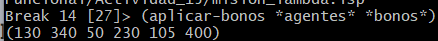

**¿por qué se escribe #'car y no solo car?**

Esto es por que como tal se esta aplicando una funcion y esa es la nomenclatura para poder aplicar esta misma, ya que si no se pone `#'` la funcion no se evaluara.

## Misión 3 - El Mensaje Interceptado

**Historia**

`*interceptado*` es una lista de palabras; cada palabra es una lista de números. El enemigo usa un desplazamiento de César:

- la letra en la posición `i` del alfabeto `(con a = 0)` se envía como `(i + 3) mod 26`.

Para descifrar hay que hacer el camino inverso y convertir el índice en letra con `*alfabeto*`.

- Mensaje descifrado:
- Versión en una sola expresión:
- (Extra) comprobación de cifrado:

**Descifrar codigo**

```
(defun descifrar-codigo (numero)
  (nth (mod (- numero 3) 26) *alfabeto*)
)
```

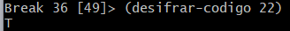

**Descifrar palabra**

```
(defun descifrar-palabra (palabra)
  (mapcar #'descifrar-codigo palabra)
)
```

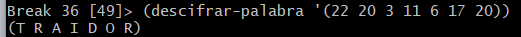

**Descifrar mensaje**

```
(defun descifrar-mensaje (mensaje)
  (mapcar #'descifrar-palabra mensaje)
)
```

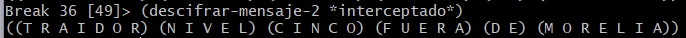

**Descifrar mensaje en una sola expresion**

```
(defun descifrar-mensaje-2 (interceptado)
  (mapcar (lambda (lista) (mapcar (lambda (i) (nth (mod (- i 3) 26) *alfabeto*)) lista)) interceptado)
)
```

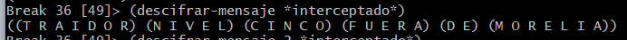

## Misión 4 - El Traidor

**Historia**

El mensaje de la Misión 3 describe al traidor. Deben encontrarlo con código, no a ojo: el cuartel pedirá repetir el filtro con otros expedientes.

- Sospechoso(s):
- Total de puntos de los leales:
- Promedio de edad (racional y decimal):
- Deducción de los dos nivel 5:

**Sospechoso**

```
(defun sospechosos (traidor)
  (remove nil (mapcar (lambda (agente) (if (and (= (nivel agente) (car traidor)) (not (string-equal (base agente) (car (cdr traidor))))) (nombre agente) nil)) *agentes*))
)
```

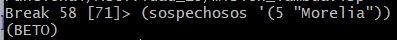

**Leales**

```
(defun leales (agentes traidor)
  (remove nil (mapcar (lambda (agente) (if (string-equal (nombre agente) traidor) nil agente)) agentes))
)
```

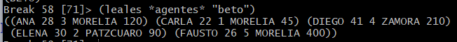

**Total de puntos**

```
(defun total-puntos (agentes)
  (reduce #'+ (mapcar #'puntos agentes))
)
```

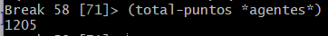

**Promedio de edad**

```
(defun promedio-edad ()
  (let ((edades (mapcar #'edad (leales *agentes* "beto")))) (/ (reduce #'+ edades) (float (length edades))))
)
```

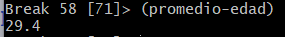

**Pregunta: CLISP no devuelve 29.4 como promedio. ¿Qué devuelve, qué tipo de número es y cómo se obtiene la versión decimal?**

Da como resultado 147/5 lo cual seria una fraccion, que es un tio de dato ratio, y para poder hacer que aparesca en decimal se debe usar float para poder cambiar esta cantidad a decimal.

**Deducción: hay dos agentes de nivel 5. ¿Qué parte del mensaje descarta a uno de ellos? ¿Qué pasaría si el filtro solo revisara el nivel?**

Lo que hace que el mensaje desacrte a uno de los agentes de nivel 5 es que el ajente traidor esta fuera de morelia, y si solo se revisara el nivel habria 2 sospechosos que serian beto y fausto.

## Misión 5 - Codigo sabotaje

**La Historia**

Un infiltrado alteró cinco líneas de un compañero. Cuatro truenan con un error; una no truena pero entrega un resultado incompleto, y por eso es la más peligrosa.

- Sabotaje silencioso y regla de mapcar:

| ID | ¿Truena? | Mensaje / resultado | Causa | Corrección |
|:----:|:----:|:----:|:----:|:----:|
| S1 | No | SYSTEM::READ-EVAL-PRINT: variable CAR has no value | Falta poner #' para que no de error | agregar #' -> (mapcar #'car *agentes*)| 
| S2 | Si | FUNCTION: lambda-list for :LAMBDA should be a list, not AG | ag debe estar entre parentesis | poner ag en parentesis -> (mapcar (lambda (ag) (nombre ag)) *agentes*) | 
| S3 | Si | EVAL/APPLY: too many arguments given to :LAMBDA | Un argumento de mas | eliminar *bonos* -> (mapcar (lambda (ag) (puntos ag)) *agentes*) | 
| S4 | Si | (130 340 50) | Nada | Nada | 
| S5 | Si | FUNCALL: argument (LAMBDA (AG) (NOMBRE AG)) is not a function | no evalua la funcion lambda | eliminar ' -> (mapcar (lambda (ag) (nombre ag)) *agentes*) | 

**¿Cuál es el sabotaje silencioso? ¿Qué regla de mapcar con varias listas explica su resultado?**

Que no se respeta la estructura de mapcar, o se agregan parametros inecesarios.

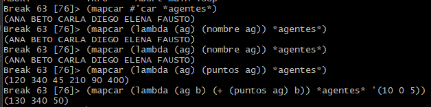

## Misión 6 - La Fabrica de Filtros

**La Historia**

El cuartel pide filtros nuevos cada semana: "nivel 4 o más", "solo Zamora", "Morelia y nivel 3 o más"… En lugar de escribir una función por pedido, construirán una fábrica: funciones que regresan lambdas.

- Salidas de los tres filtros:
- Salida del ensamble final:
- Ventaja de la fábrica:

**Filtro del nivel**

```
(defun filtro-nivel (minimo)
    (lambda (agente) (>= (nivel agente) minimo))
)
```

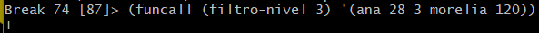

**Filtro de base**

```
(defun filtro-base (ciudad)
  (lambda (agente) (equal (base agente) ciudad))
)
```

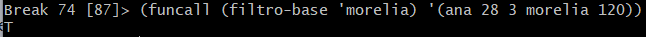

**Filtros convinados**

```
(defun y-filtros (f1 f2)
  (lambda (agente) (and (funcall f1 agente) (funcall f2 agente)))
)
```

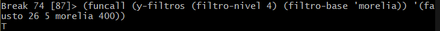

**Aplicar filtros**

```
(defun aplicar-filtro (filtro agentes)
  (remove nil (mapcar (lambda (agente) (if (funcall filtro agente) agente nil)) agentes))
)
```

* Agentes de nivel 4 o más;

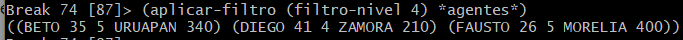

* Agentes de Morelia;

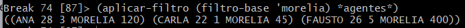

* Agentes de Morelia y nivel 3 o más.

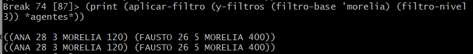

**Informe**

```
(defun informe (agentes)
  (mapcar 
    (lambda 
      (agente) 
      (format t "~A edad: ~A (~A) nivel: ~A -> puntos: ~A~%" (nombre agente) (edad agente) (base agente) (nivel agente) (puntos agente))
    ) agentes) (length agentes)
)
```

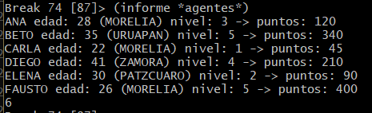

**Ensable final**

```
(informe (aplicar-filtro (filtro-nivel 3) (leales *agentes* 'beto)))
```

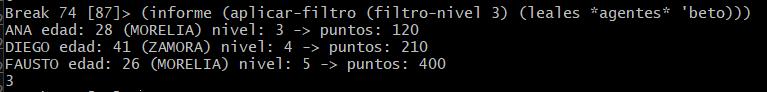

**Pregunta: ¿qué ventaja tiene `(filtro-nivel 4)` frente a escribir `(defun nivel-4-o-mas (ag) ...)`? Piensa en el pedido "nivel 2, 3, 4 y 5".**

Que permite poder modificar los parametros sin necesidad de crear una funcion para cada una delas variables.