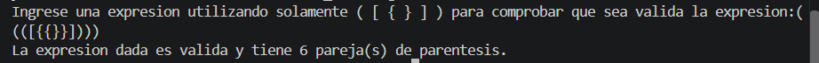
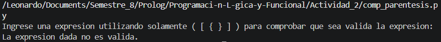
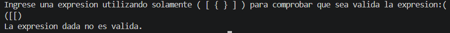

# Ejercicio 2 - Comprobacion de expresiones que tienen parentesis

**Instrucciones**

Elaborar un pragrama en el cual se introdusca una expresion compuesta unicamente por parentesis `()`, corchetes `[]` o llaves `{}`, que esten agrupados en parejas (parentesis de cierre y apertura), asi como utilizar pilas para poder realizar el ejercicio.

## Desarrollo

Para la realizacion de la actividad se utilizaron listas que seran utilizadas como pilas, aqui se almacenaran los elementos de nuetsra expresion, en donde cada que se encuentre una pareja de parentesis se sacara de la pila, de esta manera cuando todas las parejas de parentesis, corchetes o llaves sean eliminadas y la expresion haya sido recorrida de priincipio a fin, deberan obtener dos posibles resultados.
Un resultado valido es cuando la expresion dada es correcta y la pila esta vacia, esto es debido a que cada parentesis de apertura debe tener su parentesis de cierre. Miestras que el segundo resultado posibles es cuando la expresion es incorrecta, esto ocurre cuando se tiene un parentesis incorrecto, ya sea un parentesis de apertura sin uno de cierre o la expresion esta mal escrita, esto dara como resultado que la pila nunca se vacie aun que se recorra toda la expresion por tal motivo, la expresion no sera valida.

- - -

Para poder desarrollar la actividad se utilizo un metodo llamado `comp_paren()` en el cual se tiene la logica de comprobacion de la expresion compuesta por parentesis. 

```
def comp_paren(expre):
    stackPare = []
    cont_pare = 0;
    if expre:
        stackPare.append(expre[0])
        for i in range(1, len(expre)):
            stackPare.append(expre[i])
            if len(stackPare) > 1:
                if stackPare[-2] == "(" and stackPare[-1] == ")":
                    stackPare.pop()
                    stackPare.pop()
                    cont_pare+=1
                elif stackPare[-2] == "[" and stackPare[-1] == "]": 
                    stackPare.pop()
                    stackPare.pop()
                    cont_pare+=1
                elif stackPare[-2] == "{" and stackPare[-1] == "}":
                    stackPare.pop()
                    stackPare.pop()
                    cont_pare+=1
        if not stackPare:
            return cont_pare
        else:
            return False
```
En el codigo anterior muestra el funcionamiento principal del metodo de comprobacion de los parentesis en una expresion. Para ello la funcion recibe como parametro la cadena o expresion a comrobar introducida por el usuario, dentro del metodo se declaran 2 variables, una que es `stackPare` la cual sirve como pila; la cul almacena los valores de la espresion, y la variable `cont_pare` con la cual se cuantan cuantas parejas de parentesis existen en la expreion.
Dentro del funcionamiento de la funcion se tiene un condificional `if` con el cual se comprueba que la cadena no este vacia. En donde si la cadena no esta vacia continua con la ejecucion y en la primera posicion de la pila se agrega el primer valor de la expresion, despues de almacenar el primer valor, la funcion entra en un ciclo `for` el cual se ejecutara hasta que se llegue al final de la expresion.
Dentro del ciclo cada que se recorre un elemento dentro de la cadena se va almacenado en la pila, esta accion se realiza hasta que se introduce un parentesis de cierre; en caso de que esto ocurra se entran a las diferentes condicoinales que existen, donde comprueba que si en la ultima posicion de la pila hay un parentesis de cierre, y en la penultima posicion hay un parentesis de apertura, en donde si se cumple la condicional, se eliminaran ambos elementos de la pila, de esta manera cada que se encuentre una apreja de parentesis, corchetes o llaves se leminaran a la vez, asi si la pila se encunetra vacia al final de la iteracion se retornara la cantidad de parentesis encontrados en la expresion, mietras que si la expresion es incorrecta y la pila no esta vacia quiere decir que algun parentesis esta mal colocado o que hay algun parentesis de mas. siendo en ste caso que regrese un `false`

Dentro del metodo `main()` se tiene un input el cual permite alamecenar la expresion introducida por el usuario, la cual es enviada como parametro en la funcion `comp_paren()`, despues se almacena el resultado en una variable la cual si el resultado alamcenado es diferentes de `false` mostrara un mensaje de validacion junto con la cantidad de parentesis que se tengan, en caso contrario mostrara un mensaje de no validacion.

```
def main():
    expresion = input("Ingrese una expresion utilizando solamente ( [ { } ] ) para comprobar que sea valida la expresion: ")
    resultado = comp_paren(expresion)
    if resultado:
        print(f"La expresion dada es valida y tiene {resultado} pareja(s) de parentesis.")
    else:
        print("La expresion dada no es valida.")
```

## Resultados

En las siguientes imagenes se puede apresiar las dos posibles resultados, uno cuando la expresion dada es correcta, y otro cuando no, en la primera imagen que es cuando la expresion es correcta se puede apresiar que se utilizan aprentesis anidados, y reconoce cada una de las parejas con sus respectivos parentesis, corchetes o llaves, asi mismo al teminar de comprobar si la expresion es valida o no muestra u nmensaje donde valida que la expresion es correcta y muestra la cantidad de parentesis que contiene dicha expresion.



En la esta imagen se puede apresiar como cuando no se manda ninguna expresion o la expresion no contiene los parentesis de apertura o cierre correcto, nos da como resultado que la expresion no es valida.




