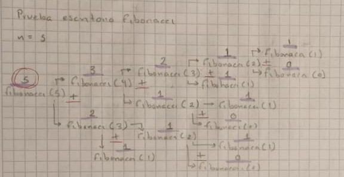
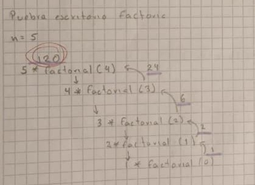
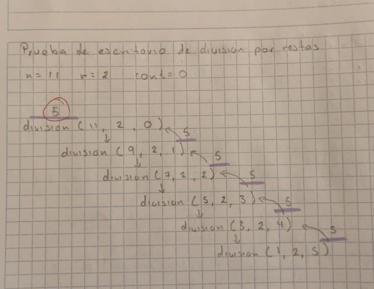

# Ejercicio 3 - Prueba de escritorio de Fibonacci, Factorial y divicion con restas.

**Instrucciones realizar la seciencias de fibonacci, el factorial de un numero y division con restas utilizando recursividad y realizando pruebas de escritorio en papel mostrando la ejecucion del codigo.**

## Desarrollo

### Secuencia Fibonacci

Para la realizancion del ejercicio, se realizo un codigo en python, el cual se tiene la funcion principal que utilizando la recursividad permite obtener el valor `n` en la secuencia fibonaccio, para ellos se tiene la funcion `def fibonacci(n)`, en esta se tiene como caso base que si `n` es menor o igual a `1` re retornara `n`, mientras que si no se comple la condicion se retornara la suma de la secuencia fibonacci de `n-1` mas `n-2`, asi hasta complir con el caso base.

```
def fibonacci(n):
    if (n<=1):
        return n
    else:
        return fibonacci(n-1) + fibonacci(n-2)
```

Para comprobar el funcionamiento del codigo antes mensionado se realizo una prueba de escritorio en papel en el cual cada vez que se realiza una llamda recursiva de muestra como se divide el codigo, haciendo difurcaciones como su fuera un arbol, que cada que se ejecuta va descomponiendose hasta llevar al caso base, y donde cada vez que llega al caso base, retorna el valor y se va sumandohasta llegar al valor del sa secuencia fibonacci en la posicion `n`.



En este ejemplo se utilizo `n=5`, el cual da como resultado `5` dentro de la secuencia de fibonacci. 

### Factorial

La funcion principal para realizar el factorial de un numero utilizando recursividad de un valor `n` utiliza la funcion `def factorial(n)`, en esta se tiene como caso base que si `n` es igual a `0` re retornara `1`, mientras que si no se comple la condicion se retornara la multiplicacion de `n` por la funcion factorial de `n-1`, hasta llegar al caso base.

```
def factorial(n):
    if (n == 0):
        return 1
    else:
        return n * factorial(n-1)
```

Al realizar la prueba de escritorio del factoria, se muestra como esta se va difurcando cada vez en mas funciones recursivas, en donde `n` va disminullendo conforme se realiza cada recursividad siendo asi que cuando llega a `0` se retorna un `1` permitiendo llevar al valor del factorial correspondiente a `n`.



Para este caso se utilizo el factorial de 5, dando como resultado 120.

### Division utilizando restas

Para realizar la division utilizando restas se utilizo la funcion `def division(n, r, cont=0)`, en esta se tiene como caso base que si `n` es menor a `r` re retornara `cont`, mientras que si no se comple la condicion se retornara funcion de division con los nuevos parameteros siendo `n-r, r, cont + 1`, asi hasta llegar al caso base.

En este programa se va tiene como a `n` el dividendo y a `r` como el divisor, miestras que `cont`, cuanta cuantas veces se puede restar el dividor al dividendo.

```
def division(n, r, cont=0):
    if (n < r):
        return cont
    else:
        return division(n - r, r, cont + 1)
```
Al realizar prueba de escritorio se puede ver de manera similar que con el factorial la recursividad lineal del programa hastallegar a un caso base.
En este caso se utilizo un `n` igual a 11 y un `r` igual a 2.


