### De la lista `(car '(1 2 3 4 5 6 7 8 9 10))` optener el 6, 8 y 10

#### Optencion del 6 `(cadr (cddddr '(1 2 3 4 5 6 7 8 9 10)))`

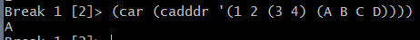

#### Optencion del 8 `(cadddr (cddddr '(1 2 3 4 5 6 7 8 9 10)))`

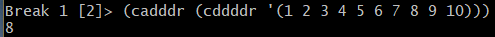

#### Optencion del 10 `(cadr (cddddr (cddddr '(1 2 3 4 5 6 7 8 9 10))))`

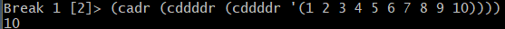

### De la lista `(1 2 (3 4) (A B C D))`

#### Optencion de la D `(cadddr (cadddr '(1 2 (3 4) (A B C D))))`

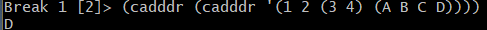

#### Optencion de la C `(caddr (cadddr '(1 2 (3 4) (A B C D))))`

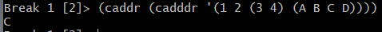

#### Optencion del 4 `(cadr (caddr '(1 2 (3 4) (A B C D))))`

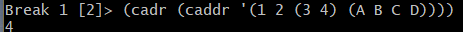

#### Optencion del 2 `(cadr '(1 2 (3 4) (A B C D)))`

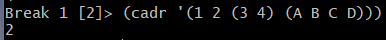

#### Optencion de la A `(car (cadddr '(1 2 (3 4) (A B C D))))`

### De la lista `((A B C) (R (T X) (Z W)))`

#### Optencion de la W `(cadr (caddr (cadr '((A B C) (R (T X) (Z W))))))`

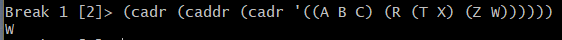

#### Optencion de la Z `(caaddr (cadr '((A B C) (R (T X) (Z W)))))`

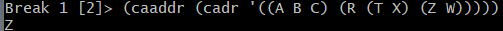

#### Optencion de la T `(caadr (cadr '((A B C) (R (T X) (Z W)))))`

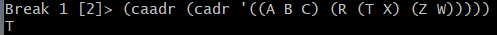

#### Optencion de la R `(caadr '((A B C) (R (T X) (Z W))))`

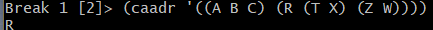

#### Optencion de la X `(cadadr (cadr '((A B C) (R (T X) (Z W)))))`

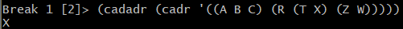

#### Optencion de la A `(caar '((A B C) (R (T X) (Z W))))`

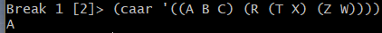

### De la lista `((((a b) (c d) (f g))))`

#### Optencion de la A `(caaaar '((((a b) (c d) (f g)))))`

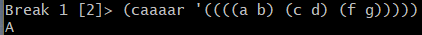

#### Optencion de la B `(cadr (caaar '((((a b) (c d) (f g))))))`

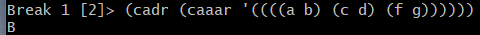

#### Optencion de la C `(caadr (caar '((((a b) (c d) (f g))))))`

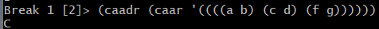

#### Optencion de la D `(cadr (cadr (caar '((((a b) (c d) (f g)))))))`

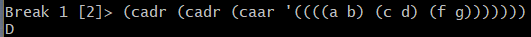

#### Optencion de la F `(caaddr (caar '((((a b) (c d) (f g))))))`

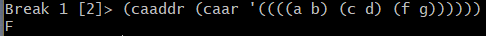

#### Optencion de la G `(cadadr (cdr (caar '((((a b) (c d) (f g)))))))`

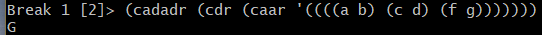
