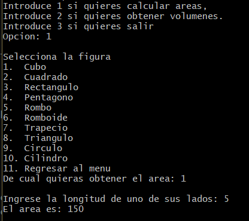
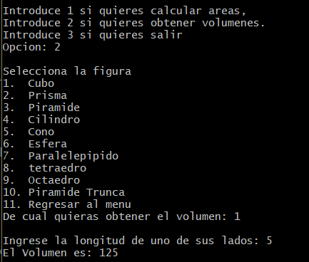
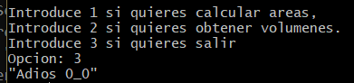

# Actividad 9 - Programa de calculo de Areas y volumenes en Clisp

## Desarrollo

### Llamado a archivos externos

Para poder desarrollar un programa que mostrara un menu con las opciones de poder calcular el volumen o area de una figura geometrica se utilizo un archivo externo en el cual se tienen las formulas para poder calcular las areas o volumenes de las figuras. Este archivo utiliza funciones primitivas para poder obtener dicho valor. 
Por tal motivo para poder cargar un archivo externo a nuestro programa principal se deve utilizar el comando `(load "Direccion del archivo")` esta linea debe ir al inicio del documento antes de declarar el funcionamiento principal del programa.

### Funcion principal ask-option

La funcion principal que permite ejcutar la logica central del programa se llama `(defun ask-option ())` en la cual se utilizan principlaamnete 4 funciones primitivas las cuales son `format` con la cual se muestra un texto en pantalla, tambine se utiliza `let` para poder asignar valores a las variables a travez de `read`, con lo cual se lee lo que introduce el usuario en consola y lo almacena en una variable con `let`, tambine se utilizan los condiciones `if`, dentro de algunos if se utiliza `numberp` con el cual se verifica si el valor dado es un numero y los `case` para poder hacer que dependiendo de una serie de casos se ejecuten diferentes acciones, siendo en este caso el obtener areas, volumenes o salir.

```
(defun ask-option ()
    (format t "Introduce 1 si quieres calcular areas,~%Introduce 2 si quieres obtener volumenes.~%Introduce 3 si quieres salir~%Opcion: ")
    (let ((opt (read)))
        (if (numberp opt)
            (case opt
                (1 
                    (opt-area)
                    (ask-option)
                )
                (2 
                    (opt-volum)
                    (ask-option)
                )
                (3 
                    "Adios 0_0"
                )
                (otherwise 
                    (ask-option)
                )
            )
            (ask-option)
        )
    )
)
```

Dentro de la funcion principal se muestra un menu con las opciones disponibles, 1) para optener las areas,, 2) para el calculo de volumenes y 3) para poder salir del programa. Esto es devido a que una vez que se ejecuta la actividad principal vuelve a mostrar el menu de opciones ya que se llama asi misa al terminar, de igual manera al ejecutarse la opcion 1 o 2 vuelve a llamar a `ask-option`. Al seleccionar la opcion 1 o 2 manda a llamar a las funciones `(defun opt-area())` y `(defun opt-volum())` respectivamente. Miestras que si se selecciona el 3 la funcion muestra en pantalla un `Adios 0_0` y se termina de ejecutar el programa.

### Funciones opt-area y opt volum

Dentro de esas funciones se ejecuta una series de instrucciones que funcionan de la misma manera que el menu principal pero con la unica del funcionamiento de cada case.
Dentro de cada funcion hay 11 opciones, de las opciones 1-10 son para calcular el area o volumen de las figuras geometricas posibles, miestras que la opcion 11 en ambas funciones tiene un `nil` con lo cual retorna al menu principal siguiendo en bucle recursivo como se explico anteriormente.
Cuando se ingresa algun numero diferente a las opciones ants mensionadas o un caracter se muestra mensajes que piden que se ingrese un valor valido, y regresan al menu de areas.

```
    (if (numberp area)
        (case area
            ...
            (11 
                nil
            )
            (otherwise 
                (format t "Opcion no valida")
            )
        )
        (format t "Debes introducir un numero")
    )
    (format t "~%")
    (if (and (numberp area) (/= area 11))
        (opt-area)
    )
```
Estas mismas instrucciones se aplican en el calculo de volumenes donde lo unico que cambia es la variable de `area` pasa a `vol`.

Para el funcionamiento del los case con los cuales se manda a llamar la funcion que calcula el area o volumen de una figura se utiliza la siguiente estructura. Primero se utiliza un `format` con el cual se pide al usuario que ingrese un valor, despues usando un `let` se almacena en una variable el valor ingresado y con un `format` nuevamente dentro del `let` se muestra el valor del llamdo de la funcion.
En caso de necesitar varios paramentros se anida el llamado de la peticion de datos al usuario hasta pedirlos todos y mandar a llamar a las funciones de calculo de area o volumen que se ocupen.

**Calculo de Area**

```
(defun opt-area()
    (format t "~%Selecciona la figura~%1.  Cubo~%2.  Cuadrado~%3.  Rectangulo~%4.  Pentagono~%5.  Rombo~%6.  Romboide~%7.  Trapecio~%8.  Triangulo~%9.  Circulo~%10. Cilindro~%11. Regresar al menu~%De cual quieras obtener el area: ")
    (let ((area (read)))
        (format t "~%")
        (if (numberp area)
            (case area
                (1 
                    (format t "Ingrese la longitud de uno de sus lados: ")
                    (let ((l (read)))
                        (format t "El area es: ~A~%" (a_cubo l))
                    )  
                )
                ...
                (7 
                    (format t "Ingrese la longitud su base mayor: ")
                    (let ((b_ma (read)))
                        (format t "Ingrese la longitud su base menor: ")
                        (let ((b_me (read)))
                            (format t "Ingrese la longitud de la altura: ")
                            (let ((h (read)))
                                (format t "El area es: ~A~%" (a_trapecio b_ma b_me h))
                            )
                        )
                    )
                )
                ...
            )
        )
    )
)
```

**Calculo de Volumenes**

```
(defun opt-volum()
    (format t "~%Selecciona la figura~%1.  Cubo~%2.  Prisma~%3.  Piramide~%4.  Cilindro~%5.  Cono~%6.  Esfera~%7.  Paralelepipido~%8.  tetraedro~%9.  Octaedro~%10. Piramide Trunca~%11. Regresar al menu~%De cual quieras obtener el volumen: ")
    (let ((vol (read)))
        (format t "~%")
        (if (numberp vol)
            (case vol
                (1 
                    (format t "Ingrese la longitud de uno de sus lados: ")
                    (let ((l (read)))
                        (format t "El Volumen es: ~A~%" (v_cubo l))
                    )  
                )
                (2
                    (format t "Ingrese el area de la base: ")
                    (let ((a_b (read)))
                        (format t "Ingrese la altura: ")
                        (let ((h (read)))
                            (format t "El volumen es: ~A~%" (v_prisma a_b h))
                        )
                    ) 
                )
                ...
                (7 
                    (format t "Ingrese la longitud del largo: ")
                    (let ((a (read)))
                        (format t "Ingrese la longitud del ancho: ")
                        (let ((b (read)))
                            (format t "Ingrese la longitud de la altura: ")
                            (let ((c (read)))
                                (format t "El volumen es: ~A~%" (v_paralelepipido a b c))
                            )
                        )
                    ) 
                )
                ...
            )
        )
    )
)
```

### Resultados

**Seleccion de la opcion 1**



**Seleccion de la opcion 2**



**Seleccion de la opcion 3**

